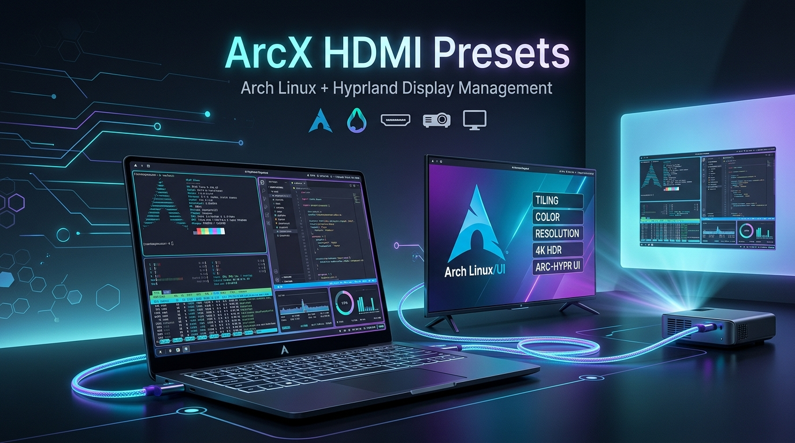

<div align="center">



# ⚡ ArcX HDMI Presets
### *Next-Level Display Management & Screen Sharing Toolkit for Arch Linux & Hyprland*

[](https://archlinux.org/)
[](https://hyprland.org/)
[](https://www.gnu.org/software/bash/)
[](https://python.org)
[](LICENSE)

<p align="center">
  <b>Pixel-perfect 1080p presets</b> • 
  <b>Dynamic DRM port auto-detection</b> • 
  <b>Zero-config Smart TV browser streaming</b> • 
  <b>One-click laptop restoration</b>
</p>

---

</div>

## 📖 Overview

**ArcX HDMI Presets** is a display management toolkit tailor-made for Arch Linux power users running **Hyprland**. Connecting a high-resolution laptop to an external TV or Projector often results in blurry fractional scaling, flickering, or leftover ghost screens. 

ArcX solves this by giving you:
- **Pixel-perfect external presets** (1920x1080@60Hz, 1.0x scale) with automatic power-off for the laptop screen (`eDP-1`) via hardware DPMS.
- **Dynamic DRM port detection** across `/sys/class/drm/` to detect active `HDMI-A-1`, `DP-1`, and other ports automatically.
- **Zero-setup wireless web casting** (`tv-stream.py`) using `grim` to stream your Hyprland desktop to any Smart TV browser (LG webOS, Samsung Tizen, Android TV, Fire TV, Roku) over your local Wi-Fi without disrupting NetworkManager.
- **Instant laptop display recovery** with a single command whenever you unplug.

---

## ✨ Features

- 🖥️ **Smart Output Auto-Detection**: Automatically identifies connected display ports from kernel DRM sysfs interfaces.
- 📽️ **Crisp TV & Projector Profiles**: Forces 1080p@60Hz at integer 1x scaling for razor-sharp text and zero blur.
- 🔋 **Battery & Distraction Saver**: Powers down the internal laptop panel and backlight completely when an external display is engaged.
- 💻 **Failsafe Display Restoration**: One keystroke instantly recovers the laptop display (`2160x1440@60` or custom native resolution) and turns off external outputs.
- 🌐 **Built-in Local Web Streaming Engine**: High-performance MJPEG live stream served on port 8080. Open the browser on any TV and go fullscreen!
- 📶 **Safe Miracast Integration**: Wi-Fi Direct mirroring launcher that keeps `NetworkManager` running untouched.
- 🎛️ **Dual-Mode Control**: Intuitive interactive terminal UI (`connect.sh`) or direct shell commands for hotkeys & scripts.

---

## ⚡ Quick Start

### 1. Interactive Control Center
Launch the terminal dashboard anytime:
```bash
./connect.sh
```

```text
==============================================================
           📺 HYPRLAND TV & PROJECTOR CONNECT TOOL
==============================================================
  1) 📺 TV ONLY: Use TV as Main Display (Laptop Display OFF)
  2) 📽️  PROJECTOR HDMI: Projector as Main Display (1080p@60, Laptop OFF)
  3) 💻 LAPTOP ONLY: Restore Laptop Display (External OFF)
  4) 🔌 HDMI: Mirror Laptop Screen
  5) 🔌 HDMI: Extend Desktop (Dual Monitor)
  6) 📶 Wireless: Web Browser Stream (Zero setup)
  7) 📶 Wireless: Miracast / Wi-Fi Direct
  8) 🔄 Disconnect / Turn Off External Display
  9) 🔍 Check Status of HDMI / Displays / Network
 10) ❌ Exit
==============================================================
```

---

## 🕹️ Command Reference

You can run individual scripts directly or pass parameters to `connect.sh`:

| Action | Direct Command | CLI Flag | Description |
| :--- | :--- | :--- | :--- |
| **📺 TV Only** | `./tv-only.sh` | `./connect.sh tv` | Switches primary display to TV (1080p@60, 1x), turns laptop display OFF |
| **📽️ Projector Only** | `./projector-only.sh` | `./connect.sh proj` | Projector primary mode (1080p@60, 1x), turns laptop display OFF |
| **💻 Restore Laptop** | `./laptop-only.sh` | `./connect.sh laptop` | Re-enables laptop display (`eDP-1`) and disables external display |
| **🔌 HDMI Mirror** | `./tv-hdmi.sh mirror` | `./connect.sh mirror` | Mirrors laptop screen to TV/Projector |
| **🔌 HDMI Extend** | `./tv-hdmi.sh extend` | `./connect.sh extend` | Extends desktop to external display (auto-right) |
| **📶 Browser Stream** | `python3 tv-stream.py` | `./connect.sh wifi` | Starts local web stream at `http://<LAN-IP>:8080` |
| **📶 Miracast** | `./tv-miracast.sh` | `./connect.sh miracast` | Interactive Wi-Fi Direct pairing via `miracle-wifictl` |
| **🔌 Turn Off External** | `./tv-hdmi.sh off` | `./connect.sh off` | Turns off external monitor output |
| **🔍 Diagnostics** | `./projector-hdmi.sh status` | `./connect.sh status` | Prints kernel DRM ports & active Hyprland monitors |

---

## 🌐 Wireless Streaming (No Cables Required)

### Method A: Smart TV Web Browser (Universal)
Works on virtually any modern Smart TV (Samsung Tizen, LG webOS, Sony Android TV, Fire TV, Apple TV, PlayStation):

1. Ensure your laptop and TV are connected to the same Wi-Fi network (or laptop hotspot).
2. Start the streamer:
   ```bash
   ./connect.sh wifi
   # or
   python3 tv-stream.py
   ```
3. Open the built-in **Web Browser** on your Smart TV.
4. Navigate to the URL printed in your terminal:
   ```text
   http://192.168.x.x:8080
   ```
5. Click anywhere or press **Fullscreen** for seamless, low-latency mirroring!

### Method B: Miracast / Wi-Fi Direct
1. Enable **Screen Mirroring** / **Miracast** on your TV.
2. Run:
   ```bash
   ./connect.sh miracast
   ```
3. In the `miracle-wifictl` shell, type `p2p-scan`, find your TV ID, and run `connect <id>`.

---

## 🔧 Installation & Dependencies

Clone the repository to your preferred location (e.g. `~/tv`):

```bash
git clone https://github.com/Arunachalam-gojosaturo/ArcXHdmi-presets.git ~/tv
cd ~/tv
chmod +x *.sh tv-stream.py
```

### Core Requirements
- **Hyprland** (0.50+ or modern release with `hyprctl`)
- **Bash** (`bash >= 5.0`)
- **Python 3** (for `tv-stream.py`)
- **grim** (for screen capture in `tv-stream.py`):
  ```bash
  sudo pacman -S grim
  ```

### Optional Packages
- **miraclecast** (for native Wi-Fi Direct Miracast):
  ```bash
  yay -S miraclecast
  ```

---

## ⚙️ Customization

Customize default resolutions, displays, or refresh rates by editing the top variables in `tv-hdmi.sh`, `tv-only.sh`, or `projector-hdmi.sh`:

```bash
LAPTOP_DISPLAY="eDP-1"            # Your laptop internal display name
LAPTOP_MODE="2160x1440@60"        # Your laptop native resolution
LAPTOP_SCALE="1"                  # Laptop scale factor

DEFAULT_MODE="1920x1080@60"       # Target external display mode
DEFAULT_SCALE="1"                 # Target external display scale
```

---

## 🤝 Contributing

Contributions, feedback, and pull requests are warmly welcome!
1. Fork the Project
2. Create your Feature Branch (`git checkout -b feature/AmazingFeature`)
3. Commit your Changes (`git commit -m 'Add some AmazingFeature'`)
4. Push to the Branch (`git push origin feature/AmazingFeature`)
5. Open a Pull Request

---

## 📄 License

Distributed under the **MIT License**. See [`LICENSE`](LICENSE) for details.

<div align="center">
  <sub>Engineered with ❤️ for Arch Linux & Hyprland enthusiasts.</sub>
</div>
